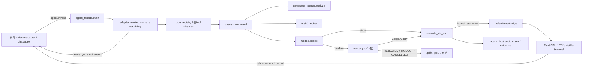

# TEAM-REVIEW-01 Agent 链路图（离线审查视图）

| 字段 | 内容 |
|---|---|
| 负责人 | EchoSinklair |
| 日期 | 2026-11-18 |
| 产品基线 | `210c7874951ddd2ca4572401225ed7decc7a5966` |
| 共享文档 HEAD | `81e7793f8471a5d843a198bdda2cc1572782b7af` |
| 关联 PR | #56 |
| 图类型 | 源码审查图（Mermaid），非原生运行截图 |

## 关键路径说明

1. 前端通过 `agent.invoke` 进入 `agent_facade.main`，由 adapter 统一调度，保持 Strands 单入口。
2. 工具执行前经过 `assess_command`：`command_impact.analyze` + `RiskChecker` + `modes.decide`。
3. `confirm` 进入 `needs_you` 审批；`allow` 直接派发；拒绝/超时/取消分别记录。
4. 命令经 `DefaultRustBridge` 调 Rust `ssh_command`；可见终端与后台通道不同。
5. 结果返回模型前经 `redact_sensitive`；日志/审计/证据分别脱敏（D6/D7 仍有 RED）。
6. 前端按 `rpc_request_id`/session 过滤迟到事件（源码可证，未做真实 E2E）。

## 归属与边界

- 图基于产品基线源码，未改生产代码。
- 不代表真实 SSH、模型或桌面端已运行；离线测试不冒称原生验收。
- 生产修复由 ROOT 负责；D1/D6/D7/D9 RED 见 `docs/updates/2026-11-18-TEAM-REVIEW-01-离线回归补证.md`。
