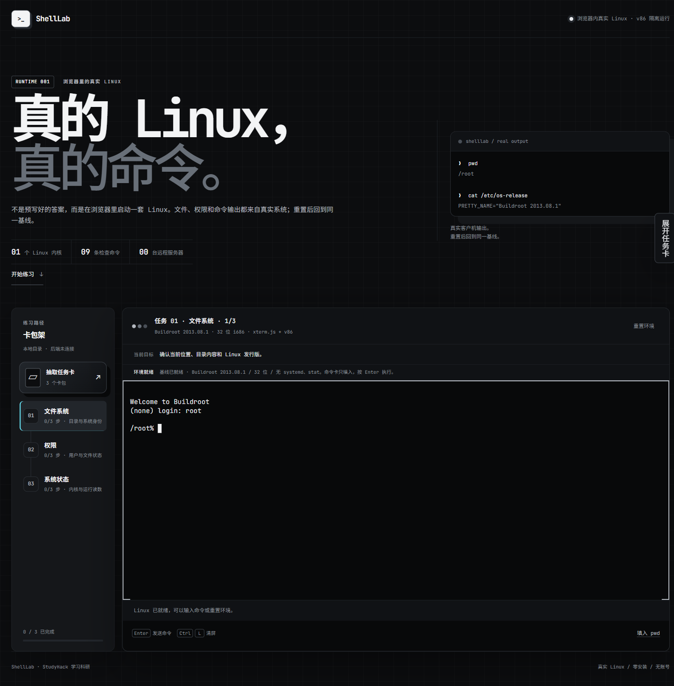
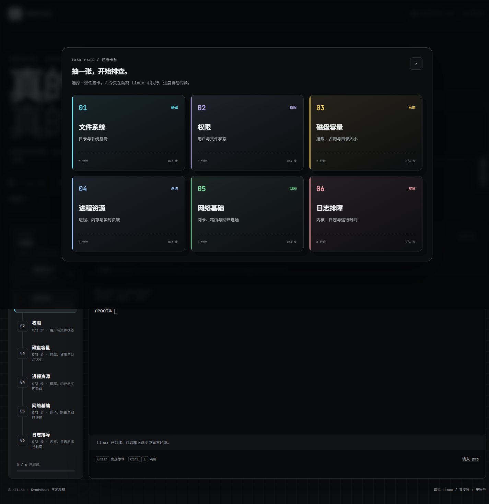
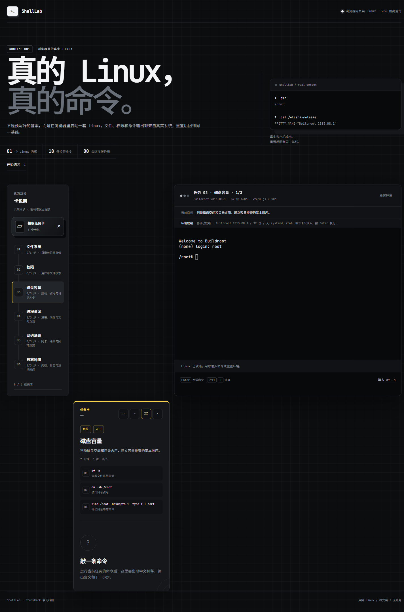
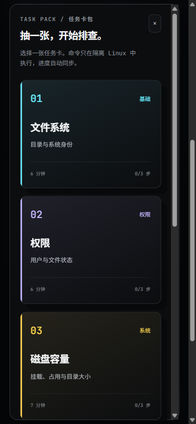
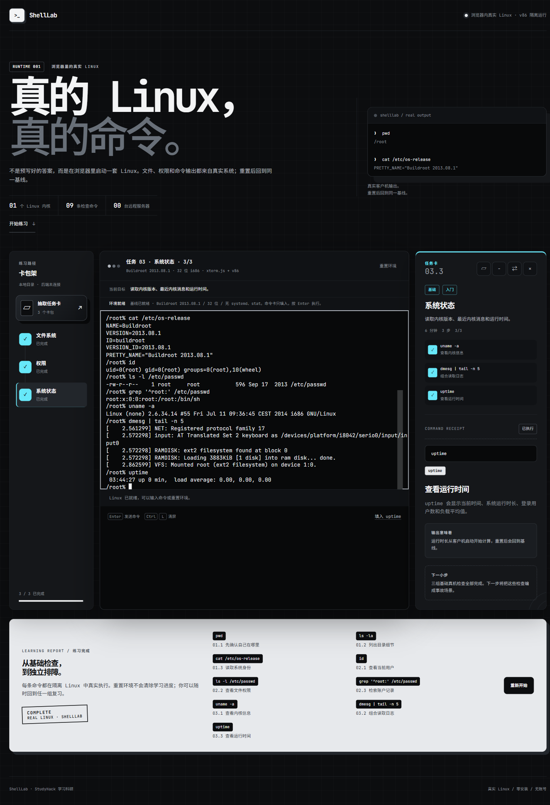

# ShellLab · 浏览器里的真实 Linux 演练场

## 2026 Qoder 高校创造力大赛项目说明书

- 赛道：StudyHack 学习科研
- 作品名称：ShellLab
- 公网地址：https://shelllab-linux-swyzioy6s1k.qoder.website
- 文档日期：2026-11-28
- 团队 / 成员：【待填】
- 学校 / 专业 / 年级：【待填】
- Qoder 账号 UID：【待填】

> 文档中的【待填】项需要参赛者本人补充。不要填写密码、API Token、私人证件或服务器凭据。

## 1. 项目摘要

ShellLab 是一个面向 Linux 初学者的浏览器学习产品。学习者在网页中启动一套隔离的 Buildroot Linux，通过真实命令输出练习文件系统、权限、磁盘容量、进程资源、网络基础和日志排障。作品不提供预写答案，也不连接用户的电脑或服务器；每条命令都在浏览器内的客户机真实执行。

当前版本包含 6 个任务卡包、18 个学习步骤，支持命令填入、真实执行、输出证据判定、中文解释、任务卡弹出/折叠/停靠、客户机基线保存与一键重置。公网静态版保留完整任务目录，学习进度保留在当前页面内存；后端可用时可启用匿名云端进度。

作品已通过 Qoder Sites 发布为公网静态站点，并完成真实 Linux 启动、root 登录、18 步通关、50 次重置、移动端布局和终端末行显示验收。

## 2. 背景与问题

Linux 入门者常见的问题不是“记不住命令”，而是“看到输出后不知道下一步判断什么”。例如：

- 会敲 `ls`，但不理解权限位、所有者和目录项之间的关系。
- 会敲 `df`，却不清楚应先看文件系统还是目录占用。
- 会敲 `ps`，但不了解如何结合内存和负载判断资源状态。
- 面对真实服务器时，担心误操作，又缺少可以反复重置的练习环境。

传统在线终端通常面临两类问题：一类只展示命令与固定答案，无法证明命令真的执行；另一类需要用户安装虚拟机或连接远程服务器，学习门槛和安全性要求较高。

ShellLab 试图把“敲命令”变成“观察真实状态并作出判断”的短练习，让学习者在安全、可重置、零安装的环境中建立基础排障直觉。

## 3. 产品定位与目标

### 3.1 目标用户

- 掌握少量 Linux 基础命令、但缺乏真实系统经验的学生。
- 需要为实验、课程设计或服务器运维打基础的自学者。
- 希望先无风险体验 Linux 命令行，再决定是否安装虚拟机的用户。

### 3.2 学习目标

完成六组任务后，学习者能够：

1. 确认当前目录、系统身份和文件权限。
2. 按“文件系统 → 目录占用 → 文件清单”的顺序检查容量问题。
3. 结合进程、内存和负载读取基础资源状态。
4. 识别网卡、路由和回环连通性的基本信息。
5. 从内核版本、日志和运行时间中提取排障线索。
6. 理解真实输出与命令回显、提示符之间的区别。

### 3.3 当前边界

- 客户机镜像为 Buildroot 2013.08.1、32 位 i686，不是现代完整发行版。
- 镜像无 systemd、`stat` 和现代包管理，不用于生产环境。
- 当前公网版不使用真实 SSH，不执行宿主命令，不读取本机文件。
- 当前进度仅保留页面内存；云端匿名进度代码已实现，但需要支持 Database/Functions 的 Qoder 套餐。

## 4. 核心功能与使用流程

### 4.1 五步使用流程

1. 打开 ShellLab，等待 Linux 镜像启动。
2. 在 `login:` 后输入 `root`，无需密码；这是镜像内账号。
3. 点击“抽取任务卡”，选择一个卡包。
4. 点击“填入命令”，在真实终端按 Enter 执行，查看输出与中文解释。
5. 完成步骤后继续下一张卡；点击“重置环境”恢复客户机基线。

### 4.2 六组任务卡包

| 卡包 | 目标 | 主要命令 |
|---|---|---|
| 01 文件系统 | 确认位置、目录内容和系统身份 | `pwd`、`ls -la`、`cat /etc/os-release` |
| 02 权限 | 查看用户与系统文件权限 | `id`、`ls -l /etc/passwd`、`grep '^root:' /etc/passwd` |
| 03 磁盘容量 | 判断文件系统与目录占用 | `df -h`、`du -sh /root`、`find /root -maxdepth 1 -type f \| sort` |
| 04 进程资源 | 查看进程、内存与负载 | `ps`、`top -b -n 1`、`free -m` |
| 05 网络基础 | 检查网卡、路由和回环 | `ifconfig -a`、`route -n`、`ping -c 1 127.0.0.1` |
| 06 日志排障 | 从内核信息中提取线索 | `uname -a`、`dmesg \| tail -n 5`、`uptime` |

网络卡包按镜像真实行为设计：`ping -c 1 127.0.0.1` 会返回 `Network is unreachable`，作品把它作为诊断证据，而不是伪造成功。

### 4.3 任务卡与反馈

- 卡包采用青、紫、琥珀、蓝、绿、玫红六种类别色。
- 任务卡可弹出、折叠、停靠左侧/右侧，关闭后可从边缘标签恢复。
- 每步显示目标、难度、预计时长、步骤清单和实时进度。
- 命令执行后显示中文解释、输出含义和下一小步。
- 错误命令不推进；命令正确但证据不足时显示“输出证据不足”。
- 完成全部步骤后生成复盘清单，支持回到任意卡包复习。

## 5. 界面与交互设计

ShellLab 采用深黑终端视觉、JetBrains Mono 等宽字体和克制的类别色，突出真实命令与输出。页面不依赖外部字体或 CDN，主要运行时资产均本地化。









设计重点：

- 终端是主工作区，任务卡只提供提示，不代替用户执行。
- 右侧回执把空格显示为 `·`，避免不可见字符造成误读。
- 320/360/390/430px 均无横向溢出。
- 主要操作按钮触摸高度不小于 44px。
- 终端列数随容器变化，任务卡在手机上变为底部弹出层。
- 页面保留单一状态播报区域，并开启 xterm 读屏模式。
- FitAddon 观测无内边距内层容器，桌面与手机末行均完整显示。

## 6. 技术方案

### 6.1 总体架构

- 前端：原生 HTML/CSS/JavaScript，xterm.js 6.0.0 与 `@xterm/addon-fit`。
- 运行时：v86 在浏览器内执行 i686 x86 指令，加载本地 WASM、SeaBIOS、VGA BIOS 与 Buildroot ISO。
- 终端通信：通过串口字节流发送 UTF-8 输入，解析 ANSI 输出并识别 shell 提示符。
- 学习状态机：`ShellSession` 管理任务、步骤、输入、回执、进度与命令队列。
- 任务目录：`backend/functions/tasks.json` 与静态 `site/catalog.json` 使用同一份 6 包 18 步内容。
- 可选后端：Qoder Sites Function 提供任务目录、匿名会话、进度、幂等尝试与重置 API。
- 发布：Qoder Sites 静态站点；Function/Database 代码与 schema 已保留。

### 6.2 真实执行与证据判定

1. 用户点击“填入命令”时，只向隔离终端写入命令文本，不自动发送回车。
2. 用户按 Enter 后，命令进入真实 shell 执行。
3. 串口输出按字节到达，前端处理跨分片 ANSI 序列。
4. shell 提示符返回后，命令才结算。
5. 判定前剔除命令回显与提示符，避免把 `du -sh /root` 的回显误当成输出证据。
6. 连续输入进入队列，出队时才绑定当前任务与步骤。

### 6.3 基线保存与重置

Linux 登录完成后保存客户机基线。用户创建临时文件或改变环境后，可通过 `save_state/restore_state` 恢复。重置不会伪造输出，也不会重放可能已执行的写命令。

后端重置采用替换 learner 行并依赖外键级联的设计：旧 learner 的在飞写入会因外键失效而无法回流，新的匿名会话继续使用同一 Cookie 令牌哈希。

### 6.4 可选匿名进度

后端使用 HttpOnly 不透明 Cookie，不需要账号。数据库只保存命令/输出哈希、判定结果、次数和时间，不保存原始终端输出。写接口校验同源、请求大小、字段格式与幂等键；同一 attemptId 不同内容返回 409。

当前公网为纯静态版，不会向不可用接口发送会话或尝试写入。

## 7. 安全与隐私

- 命令只在浏览器隔离客户机内执行，不接触宿主文件系统。
- 不连接真实 SSH，不读取用户本机文件，不执行宿主命令。
- 登录页明确说明 `root` 是镜像内账号，不是服务器凭据。
- 资源加载、启动、销毁和重置均有超时与可见错误反馈。
- 静态资产、字体、BIOS、WASM 和 ISO 均本地化，不依赖第三方 CDN。
- 第三方许可证与镜像来源记录见 `THIRD_PARTY_NOTICES.md`。
- 提交前运行凭据扫描与 L3 深度安全审查，最终提交审查零发现。

## 8. Qoder 使用过程

1. **需求梳理**：用 Qoder 核验赛事要求，明确 StudyHack 赛道、目标用户、最小闭环和验收标准。
2. **方案调研**：比较在线终端、固定答案模拟器、虚拟机与浏览器内 x86 模拟方案，选择 xterm.js + v86 的真实执行路线。
3. **产品实现**：在 Qoder 中完成前端、任务状态机、六包十八步目录、卡包交互、移动端适配与本地全栈预览。
4. **后端实现**：完成任务目录 API、匿名会话、进度、幂等尝试、重置、数据库适配与受限 DDL schema。
5. **真实验收**：使用 Node 测试与 Playwright 真实浏览器探针验证 18 步通关、50 次重置、回显、ANSI、竞态、会话失败、移动端与末行几何。
6. **公网交付**：通过 Qoder Sites 发布静态站点，设置 public，并在公网复核真实 Linux 与完整任务目录。
7. **限制处理**：当前套餐不支持 Database/Functions，作品改用完整静态目录与页面内存进度，没有用假数据冒充云端进度。

## 9. 验证结果

| 验证项 | 结果 |
|---|---|
| 前端单元测试 | 45/45 通过 |
| 后端自动化测试 | 18/18 通过 |
| 六包十八步真实通关 | 6/6 卡包、18/18 步骤 |
| 客户机重置 | 50/50 成功 |
| 错误命令 | 不推进，显示“未通过” |
| 连续输入 | 按顺序逐条结算 |
| 延迟重置竞态 | 新进度不被旧重置删除 |
| 会话 503 | 显示“进度仅本机”，无无效写入 |
| 公网静态版 | 首页、目录、Linux 启动与登录通过 |
| 移动端 | 390px 无横向溢出，20 行末行完整 |
| 桌面末行 | 22 行，底部余量 30px，完整未裁切 |
| 性能快照 | 冷启 P50/P95 4137/4239ms；命令 P95 79ms；重置 P95 69ms |



性能数据来自 2026-11-26 的独立测量，2026-11-28 全套回归未重新采样 P50/P95。内存读数只作为 JS 堆代理，不冒充浏览器 RSS。

## 10. 创新点与赛事匹配

### 10.1 创新点

- **真实执行而非固定答案**：浏览器内运行 Linux，命令输出来自客户机。
- **证据驱动学习**：只有关键输出证据出现才推进步骤。
- **卡包式练习**：把命令练习组织成可抽取、可折叠、可停靠的任务卡。
- **安全可重置**：所有操作限制在隔离客户机，支持恢复同一基线。
- **零安装与移动端可用**：打开网页即可开始，手机也能完成基础练习。
- **诚实的降级**：后端不可用时保留完整教学内容，不伪造云端状态。

### 10.2 与评审维度的对应

- **问题是否真实**：初学者缺乏真实系统练习与输出判断经验。
- **核心流程是否走得通**：打开、登录、抽卡、执行、解释、重置已完整闭环。
- **体验与设计**：终端优先、卡包交互、六类颜色、移动端与状态反馈完整。
- **Qoder 使用深度**：覆盖需求、调研、实现、测试、数据库适配、部署与公网验收。
- **技术复杂度不是卖点**：作品重点展示真实学习价值与完整流程，而不是堆叠技术名词。

## 11. 当前限制与后续计划

### 11.1 当前限制

- 公网版为静态站点，学习进度刷新后不保留。
- Buildroot 镜像较旧，缺少现代发行版常用工具。
- 尚未完成 NVDA/VoiceOver 真机读屏核验。
- 尚未完成真实 iOS/Android 软键盘、旋转与后台恢复测试。
- 低端手机长时间多开压力测试尚未完成。
- 当前内容是基础诊断切片，不是完整的生产事故剧本。

### 11.2 后续路线

1. 升级 Qoder 套餐后启用匿名云端进度与跨设备续学。
2. 增加 1 个旗舰事故与 3 个专项演练，例如磁盘占满、权限拒绝、内存异常与网络不通。
3. 引入更新的 Linux 镜像，补齐现代工具与真实日志场景。
4. 增加教师视图、班级任务与学习报告。
5. 完成真机读屏、键盘全流程和低端设备压力测试。

## 12. 提交材料与检查清单

### 12.1 材料清单

- Qoder Sites 公网链接：https://shelllab-linux-swyzioy6s1k.qoder.website
- 比赛项目说明书：本文档 Markdown 与 Word 版本。
- 天池作品帖草稿：`作品帖草稿-2026-11-28.md`。
- 验收清单：`SHELLLAB-验收清单-2026-11-26.md`。
- 真实浏览器证据：`evidence/v86-learning-e2e.json`。
- 源码指纹：`evidence/source-fingerprint.json`。
- 产品截图：`evidence/shelllab-*.png`。
- 比赛分支：`codex/2026-11-26-qoder-campus-creativity`。

### 12.2 用户仍需完成

- [ ] 填写姓名、学校、专业、年级与队伍成员。
- [ ] 填写 Qoder 账号 UID。
- [ ] 完成天池实名认证和阿里云大学生认证。
- [ ] 核对作品帖标题包含 StudyHack，正文五部分齐全。
- [ ] 本人发布天池作品帖。
- [ ] 如进入决赛，按官方要求提供源代码。

## 附录 A：源码指纹与复现

- 指纹文件：`evidence/source-fingerprint.json`。
- 文件数：57。
- 聚合 SHA-256：`b59d110198897175f4764c4e56405897c3f03ced661027895e56bff5dde85df6`。

```bash
node --test site/tests/api-client.test.js site/tests/command-display.test.js site/tests/shell-session.test.js site/tests/v86-runtime.test.js site/tests/task-queue.test.js
npm --prefix backend test
node site/tests/fingerprint.mjs
npm --prefix backend run dev:full
```

本地全栈预览：`http://127.0.0.1:8080/`。本地服务使用内存存储，重启后进度清空；纯静态预览使用 `site/` 或 `dist/`。
