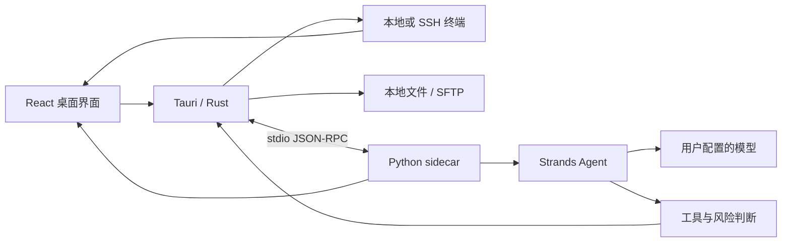

# 系统架构

本页是现行架构入口，替代并行维护多套 Wiki 的方式。源码路径用于定位，不表示本次重新运行了所有功能。

这是主要调用关系示意；不是进程隔离、所有工具均经 Rust 或沙箱有效性的证明。具体工具要沿实际注册与执行路径核对。

| 主题 | 文档 |
|---|---|
| 代码入口与影响范围 | [模块地图](modules.md) |
| 模型、RPC、工具与事件 | [Agent 链路](agent.md) |
| 审批、身份、凭据与证据 | [安全边界](safety.md) |
| 本地/WSL/SSH、目录与输入 | [终端与工作区](terminal-workspace.md) |
| 知识来源与追溯面板 | [知识与日志](knowledge-observability.md) |

架构变更须同步这里和对应专题；不在文档里固定容易漂移的工具数量、IPC 数量或测试总数。
