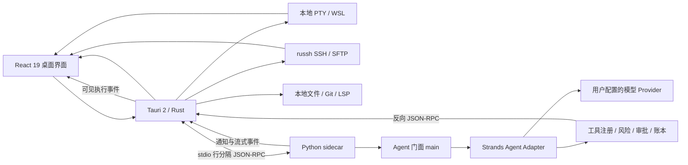

# 系统架构与 AI 快速接手

## 1. 文档信息

- 架构复核日期：2026-11-20。
- 状态：现行架构 Wiki，替代已经归档的 Repo Wiki 和 Qoder Wiki；共享审查候选仍待审，不代表已经合入 main。
- 适用范围：共享候选已有生产源码。独立安全、纠错、远程桌面和模型候选只在本页标明边界，不写成共享生产能力。
- 证据口径：本页来自源码与真实入口的只读复核，不表示本轮重新运行了全部测试、原生桌面、真实 SSH、模型或安装验收。

后续 AI 不需要从仓库根目录重新做全量探索。先读[项目状态](../STATUS.md)，再按本页定位专题和源码；开工前只需重新核对 `AGENTS.md`、本机 `.ai/CURRENT.md`、实际分支/HEAD/未提交文件、对应 Issue/PR 与受影响模块。任何新提交或工作树切换都可能使进度快照失效，但不会自动改变这里描述的稳定分层。

## 2. 背景与架构目标

TDSF 是以终端为中心的 Linux 运维 AI 桌面工作台，组合本地/WSL/SSH 终端、工作区与分屏、SFTP 文件、编辑器、AI 协作、运维教学和可追溯执行证据。

架构必须维持以下目标：

1. 命令进入真实 PTY 或 SSH 通道，保留原始输入、回显、退出状态和输出归属，不伪造执行结果。
2. 生产对话只公开 Strands `main` Agent 门面；工具注册、风险判断、审批、执行和证据形成一条可检查链路。
3. 前端会话 UUID、Rust 会话 ID、终端 leaf、工作区、shell 有效用户和文件认证身份分别建模。
4. 高频终端字节与低频 UI 状态分离；候选、审批和异步结果过期即失效。
5. 源码实现、自动测试、原生桌面、真实 SSH、真实模型和安装包验收分别陈述。

## 3. 系统架构图

这是主要调用关系，不是进程隔离、所有工具均经 Rust 或沙箱有效性的证明。远程桌面、离线纠错和端侧模型等独立候选不在此图中画成共享生产实线。

## 4. 进程与模块分解

| 层 | 真实入口 | 职责与边界 |
|---|---|---|
| 主前端 | [src/main.tsx](../../src/main.tsx)、[src/app/App.tsx](../../src/app/App.tsx) | 工作区、标签、分屏、终端、AI、SSH 与审批 UI 装配；不是完整 Web 后端 |
| 设置窗口 | [settings.html](../../settings.html)、[src/settings/main.tsx](../../src/settings/main.tsx) | 独立 Vite 页面与 Tauri 窗口，不是主 SPA 路由 |
| Rust 原生端 | [src-tauri/src/main.rs](../../src-tauri/src/main.rs)、[src-tauri/src/lib.rs](../../src-tauri/src/lib.rs) | 插件、窗口、命令注册、PTY、SSH/SFTP、sidecar 生命周期和系统状态 |
| Python sidecar | [src-tauri/sidecar/main.py](../../src-tauri/sidecar/main.py) | stdio JSON-RPC 调度、业务服务、通知与 Rust 反向调用；不是 HTTP 服务 |
| Agent 门面 | [agent_facade.py](../../src-tauri/sidecar/agent_facade.py) | 只公开已知 Agent；生产主入口为 `main` |
| Strands 适配 | [strands_backend](../../src-tauri/sidecar/strands_backend/) | 模型 Provider、每会话 Agent、动态工具集、hook、权限模式和事件 |
| 工具与执行 | [工具注册表](../../src-tauri/sidecar/strands_backend/tools/registry.py)、[执行外壳](../../src-tauri/sidecar/strands_backend/tools/__init__.py) | 风险评估、审批、操作账本、连接校验、后台或可见执行及结果归一化 |
| 终端前端 | [src/modules/terminal](../../src/modules/terminal/) | xterm 渲染池、PTY/SSH transport、OSC 命令块、输入与 dormant ring |
| AI 前端 | [src/modules/ai](../../src/modules/ai/) | 对话状态、sidecar stream、工具卡、审批卡、live bridge 与证据展示 |
| 工作区与文件 | [src/modules/spaces](../../src/modules/spaces/)、[src/modules/explorer](../../src/modules/explorer/)、[fs_backend](../../src-tauri/src/modules/fs_backend/) | Space、pane/leaf、local/WSL 文件和 SSH SFTP 视图 |
| 外部 CLI Agent | [src/modules/agents](../../src/modules/agents/) | 在终端中启动 Claude/Codex/Gemini 等外部 CLI；不是 Strands 子 Agent |
| 预测候选 | [src/modules/prediction](../../src/modules/prediction/) | 候选上下文、建议和纠错；共享保留模块不等于完整输入接线已验收 |
| 隔离实验 | [experiments](../../experiments/) | 回放或原型，不自动成为生产入口 |
| 宣传站点 | [website](../../website/) | 独立静态网站，不是产品前端 |

完整改动影响面见[模块地图](modules.md)。

## 5. 核心技术与选择理由

| 技术 | 当前用途 | 架构理由与限制 |
|---|---|---|
| React、TypeScript、Vite、Zustand | 桌面 UI 与低频状态 | 组件生态和类型边界清晰；高频终端数据不经过 React/Zustand 全量流转 |
| xterm.js、CodeMirror | 终端和编辑器 | 保留真实终端语义与编辑能力；OSC 集成是证据链的一部分 |
| Tauri 2、Rust | 桌面原生能力 | 统一窗口、权限、进程、PTY/SSH、凭据和系统资源生命周期 |
| portable-pty、russh、russh-sftp | 本地/WSL/SSH/SFTP | 直接管理真实字节流和连接，不用模拟回显替代执行 |
| Python sidecar | Agent 与本地业务服务 | 承载 Strands 生态；Rust 监管进程、心跳和反向 RPC |
| Strands | 生产 Agent | 保持唯一公开 `main` 门面和真实工具注册；前端 AI SDK 协议不等于另一套批准运行时 |
| Tauri Store、SQLite | 设置、会话、账本和知识 | 区分非敏感配置、操作证据与知识索引；密码、私钥口令和 API Key 使用系统凭据边界 |

依赖真源分别为 [package.json](../../package.json)、[Cargo.toml](../../src-tauri/Cargo.toml) 和 [sidecar pyproject.toml](../../src-tauri/sidecar/pyproject.toml)，不要从本页推断精确版本。

## 6. 核心数据流与调用链

### 6.1 普通终端输入与输出

- 本地/WSL：xterm `onData` → 前端 PTY bridge → Rust `pty_write` → portable-pty writer。
- SSH：xterm `onData` → SSH leaf transport → Rust `ssh_write` → russh channel。
- 输出由 Rust reader 推回前端，写入活动 xterm 或 dormant ring；OSC 7/133/633 提供 cwd、命令开始、命令原文、退出码和输出尾部。
- 完成的命令块进入有界 store，供终端历史、Agent 上下文和可见执行回执使用。终端显示文本不自动等于可靠执行证据。

详见[终端与工作区](terminal-workspace.md)。

### 6.2 生产 Agent 调用

1. 前端 Chat transport 在 `tdsfAgentId=main` 时进入 sidecar stream。
2. Rust `ipc_invoke` 通过 stdio JSON-RPC 调用 Python `agent.invoke`。
3. Python 门面解析唯一公开 `main`，Strands adapter 按会话和权限模式取得 Agent，并动态刷新 prompt 与工具集。
4. 工具经统一注册和策略进入风险判断、操作账本、必要的 FIFO 审批及真实连接校验。
5. Python 通知经 Rust 转成 Tauri 事件，前端按调用身份渲染工具状态与结果。

批准边界是 Strands 单运行时；共享源码仍保留空 `tdsfAgentId` 时的前端 AI SDK 工具执行 fallback，属于待收口缺口，不得描述为另一套批准生产入口。详见[Agent 链路](agent.md)。

### 6.3 后台 SSH 执行

Python 工具 → RustBridge `ssh_command` → Rust russh `channel.exec` → 原生命令结果与输出事件 → Python 工具结果 → sidecar 工具事件 → 前端工具卡。

后台结果必须保留调用 ID、Rust 会话 ID、退出状态和 stdout/stderr 归属。连接列表或目标校验失败时不能用名称猜测另一台主机。

### 6.4 可见终端执行

Python `visible_terminal_execute` → Rust 定向事件 → 前端校验 leaf/session/prompt/dirty input/alt-screen/busy → 真实 PTY 或 SSH 写入 → shell 回显与 OSC 命令块 → 前端回执 → Rust oneshot → Python 工具结果。

写命令缺少可靠结果时不得静默改到后台重放。多窗口 owner、迟到回执、取消和 scrollback 目标仍需按具体源码与原生场景复核。

## 7. 关键接口与状态边界

| 接口/状态 | 当前合同 |
|---|---|
| 前端 → Rust | Tauri command、Channel 和事件；调用名必须与 Rust 注册表一致 |
| Rust ↔ Python | stdio 行分隔 JSON-RPC；请求、响应和通知分别处理，反向调用使用 pending/request ID |
| Python → 前端 | Python notification → Rust `sidecar:<method>` 事件 → 对应 store/bridge |
| SSH 身份 | 前端 UUID 用于 UI/pane；Rust 数值 ID 用于 Agent/SFTP；两者不能互换 |
| 对话作用域 | 独立 `SessionScope` 绑定真实目标，不简单跟随全局活动 SSH |
| 终端高频数据 | renderer pool、模块级 subscriber 和 dormant ring；不全量进入 Zustand |
| 审批 | 每会话 FIFO；批准后执行 gate 保持到真实执行结束，未知/取消/拒绝分别记账 |
| 远程桌面候选 | 控制 IPC 与画面/输入数据面分开；定向 Channel、有界帧和背压仍属候选验收范围 |

## 8. 持久化、安全与非功能设计

- 设置、工作区、AI 会话、片段和技能使用各自 Tauri Store；消息按会话懒加载。
- SSH 非敏感配置与密码/私钥口令分离；API Key 不写入普通 LLM 配置。
- 操作账本使用 SQLite WAL 和明确状态机；知识库与日志分别管理，日志有界轮转。
- 命令审批不是操作系统沙箱；`python_run` 的静态分析、cwd、审批和超时不能称为文件或网络隔离。
- 网页、命令输出、知识文档和模型内容都是不可信数据，不能提升为工具授权。
- 首次启动知识库在特定配置下可能触发联网初始化；离线测试须显式控制 `TDSF_KB_AUTO_INIT`。
- 大型编排文件和多层全局状态提高了竞态维护成本，修改时必须覆盖代次、owner、目标、取消和迟到事件。

安全细则见[安全边界](safety.md)，知识与日志见[知识与日志](knowledge-observability.md)。

## 9. 开发、部署与验证

| 范围 | 现有入口 |
|---|---|
| 前端 | `pnpm dev` 仅提供 Vite 页面；完整功能需要 `pnpm tauri:dev` |
| 静态检查 | `pnpm typecheck`、`pnpm lint` |
| 前端测试 | `pnpm test`，定向使用 `pnpm test -- -t <TestName>` |
| Python | `pnpm test:python` |
| Rust | 在 `src-tauri` 执行 `cargo test --locked` |
| Web 构建 | `pnpm build` |
| Windows 整包 | `pnpm build:win`，sidecar 使用 PyInstaller onedir |

命令真源见 [package.json](../../package.json) 和[测试检查](../development/testing.md)。源码、假服务、自动测试、原生桌面、真实 SSH、真实模型和安装包结果不得合并成一句“全绿”。

## 10. 当前候选与已知缺口

| 项目 | 架构读法 |
|---|---|
| 安全边界修复 | 共享组合接线和验证范围见项目状态，Echo 的安全工作包独立评审 |
| 离线纠错 | 独立审查分支包含 WSL 证据和 ROOT 的输入归属回归，真实 SSH 与新快照原生验证继续按工作包补齐 |
| 模型参数与用量 | 独立审查分支接通参数回执与用量账本，SDK 用量按每次调用核验 |
| RDP/VNC | 独立 PR 候选；共享源码没有远程桌面产品模块，原生 RDP 和独立 VNC/RFB 不得提前宣称通过 |
| 专用端侧模型 | 研究、回放或设计草案；不进入逐键自动链路，不等于生产接入 |
| 前端 SDK fallback | 与单运行时批准边界存在差距，需清理或严格隔离，不允许借此绕开 sidecar 审批与账本 |
| scrollback 归属 | Python 请求中的会话 ID 尚未贯穿 Rust 回读与前端活动终端选择，需专项修复和多会话验证 |
| 预测 owner | 部分候选仍有本地环境硬编码或空连接身份，不能视为完整 SSH owner 合同 |

动态 PR HEAD、测试结果和下一动作看[项目状态](../STATUS.md)及对应工作包，不在长期架构页持续堆叠。

## 11. 专题地图与维护要求

| 主题 | 文档 |
|---|---|
| 代码入口与影响范围 | [模块地图](modules.md) |
| 模型、RPC、工具与事件 | [Agent 链路](agent.md) |
| 审批、身份、凭据与证据 | [安全边界](safety.md) |
| 本地/WSL/SSH、目录与输入 | [终端与工作区](terminal-workspace.md) |
| 知识来源与追溯面板 | [知识与日志](knowledge-observability.md) |
| RDP/VNC 候选架构 | [远程桌面方案目录](../plans/remote-desktop/README.md) |
| 共享范围与保留候选 | [共同开发基线](../development/shared-baseline.md) |
| AI 与多工作树协作 | [AI 协作](../development/ai-collaboration.md) |

架构变更须同步本页和对应专题；进度变更只更新状态、方案或交接。不要恢复第二套 Wiki，不在本页固定容易漂移的工具数量、IPC 数量、PR HEAD 或测试总数。
