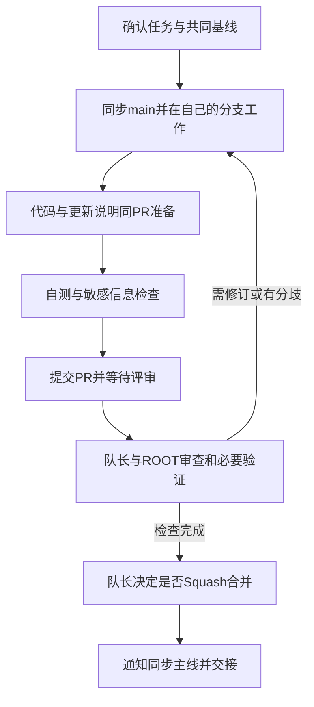

# 三人团队 GitHub 协作规范

生效日期：2026-11-13。队长负责目标、共同基线与最终合并；两名组员负责分配任务、自测和 PR；ROOT 协助方案、代码审查、回归及整合判断。AI 的检查意见不能冒充另一个人的 GitHub 审批。

**组员提交后不合并、不打开自动合并。只有队长与 ROOT 审查、验证对应提交后，才由队长决定合并。此规则对代码、测试、调研、文档和比赛材料同样生效。**



这是人工协作流程，不是已启用的自动合并或远端权限设置。

## 1. 仓库与权限

队长已于 2026-11-13 选择：EchoSinklair、Yan-0914 分别 Fork `harryopo/tdsf-terminal-agent`，在自己的 Fork 建任务分支，向上游 `main` 提 PR。协作模式不需要为成员新增主库写权限；本轮未核/改变既有权限。成员自己的 Fork 不等于拥有上游合并权限。阅读和首轮任务见 [组员入门](team-onboarding.md)。

如果队长选择同仓库分支，先核分支保护和成员权限，再下发任务。不能只靠 CODEOWNERS 或一条文字约定承诺“只有队长能合并”。本轮只写规范，没有启用或更改远端设置。

只保留一条正式主线 `main` 和短期任务分支，不另建长期 `develop` 或三份“参赛版”源码。Fork 的 main 只同步上游已确认基线，不直接开发任务。

## 2. 动工前的共同基线

队长先公布：完整基线 SHA、任务编号、负责人、允许/禁止文件、依赖、验收标准和证据范围。基线必须已在上游可获取，并完成对应范围的审阅/验证。

本机未提交改动不会出现在队员的 clone 中。不得把本机 HEAD 或远端“最新 main”自动当成本次已发布团队基线。基线未下发时，可以读规则、提任务建议，不擅自开发依赖该基线的功能。

一人同一时间优先只做一个主要任务；同一装配文件/接口由一个负责人修改。改变范围或新增依赖先由队长确认。

## 3. 分支命名

格式：`类型/YYYY-MM-DD-负责人-简述`。日期取任务开始日，负责人用本人的小写 GitHub 名称，简述用小写英文/拼音和连字符；不用空格、中文、`final` 或无意义的 `test1`。

| 类型 | 用途 | 示例（负责人是假名，不是已分配账号） |
|---|---|---|
| `feat` | 新功能 | `feat/2026-11-13-member-a-knowledge-layout` |
| `fix` | 缺陷修复 | `fix/2026-11-13-member-a-kb-empty-state` |
| `test` | 测试与合成夹具 | `test/2026-11-13-member-b-input-fixtures` |
| `research` | 来源核验与调研 | `research/2026-11-13-member-b-codearts-rules` |
| `docs` | 说明与规范 | `docs/2026-11-13-member-a-setup-guide` |
| `contest` | 比赛材料/演示 | `contest/2026-11-13-member-b-demo-script` |
| `chore` | 有界维护 | `chore/2026-11-13-member-a-doc-links` |
| `codex` | AI 执行分支 | `codex/2026-11-13-root-team-review` |

任务延续到次日不必改名；新任务开新分支。命名适用于以后新建分支，不因此重命名、重置或搬走已有未提交工作。提交信息默认用 `类型: 简述`，例如 `feat: 新增知识来源标识`、`fix: 修复知识空列表提示`；模块可选写成 `fix(knowledge): 修复空列表提示`。测试、调研、文档、比赛和维护分别用 `test:`、`research:`、`docs:`、`contest:`、`chore:`，不要用 `update` 或 `完成全部` 代替具体内容。

## 4. 组员操作流程（Fork 模式）

先在 GitHub 网页 Fork；下面是供组员收到任务后使用的示例，不是本轮已执行的命令。替换账号、SHA 和分支名，不复制示例任务当已授权任务。

```powershell
$teamAccount = 'your-github-name'
$teamBase = 'replace-with-captain-approved-full-sha'
$taskBranch = 'docs/2026-11-13-your-github-name-setup-guide'
git clone "https://github.com/$teamAccount/tdsf-terminal-agent.git"
cd tdsf-terminal-agent
git remote add upstream https://github.com/harryopo/tdsf-terminal-agent.git
git fetch upstream
git switch -c $taskBranch $teamBase
git status --short
```

已有克隆先检查工作区和远端；不要重复添加已有 upstream，也不要带未提交工作切分支。环境按 [准备说明](setup.md)建立，不复制队长本机 `.venv`、凭据或依赖目录。

完成任务后，逐个加入自己改过且核对过的文件；代码/测试/脚本变更同时加入自己的更新说明：

```powershell
git diff --check
git diff
# 示例路径需换成本次任务允许且真实修改的文件
git add -- docs/development/setup.md
# 代码任务再加入本任务实际新建的 docs/updates/日期-任务编号-简述.md
git diff --cached
git commit -m "docs: 完善本地环境准备说明"
git push -u origin $taskBranch
```

不用 `git add -A` 把本机所有内容提交。用本人身份提交，不伪造他人作者或工具贡献；不把 Token 放进 URL。只推自己的任务分支，禁止强推、改写他人历史或直接推上游 main。

项目对部分文档/比赛目录采用公开白名单。任务明确要求公开的新文件若被忽略，先由队长确认路径，再在同一PR加入精确白名单；不关闭整体保护，不强制加入私人目录，也不能因为文件被忽略就漏交配套说明。

在 GitHub 新建 PR：base 为 `harryopo/tdsf-terminal-agent:main`，compare 为自己的任务分支。未完成用 Draft；自测完成后转待审，填写 [PR 模板](../../.github/PULL_REQUEST_TEMPLATE.md)。完成按钮是“请求审阅”，不是 Merge。

## 5. 等待评审和处理反馈

PR 提供：任务编号、共同基线 SHA、当前 HEAD SHA、文件范围、行为变化、验证/截图、已知限制及真实工具使用说明。不要把原始日志、密钥或私人材料放进公开 PR。

## 5.1 固定同步 main 的节奏

每天开工、创建新任务前、发 PR 前、队长通知主线合入后同步；正在评审的 PR 遇到相关主线变化也要同步并复核。不要拖到几个大功能一起合并才发现冲突。

Fork 模式下 `upstream` 是队长主库、`origin` 是自己的 Fork。先获取，再检查工作区；只有工作区干净时才执行下面的合并：

```powershell
git fetch upstream
git status --short
# 确认当前是自己的任务分支，且没有未提交改动，再同步
git merge --no-edit upstream/main
git rev-parse upstream/main
git rev-parse HEAD
```

把 main 合入自己的任务分支只是同步，不是获准把 PR 合入主库。若要更新本地 main 镜像，先在干净工作区切到 main，再用 `git pull --ff-only upstream main`，之后回自己的任务分支继续。原有未提交工作先保留，不用强制切换、reset、覆盖或重写历史。

在任务/PR中同时记录起始基线、最近同步的 main SHA 和当前 HEAD。不要悄悄把最初任务基线改成最新值来伪装原验收已覆盖。

## 5.2 代码和更新文档一起提交

每个代码、测试或脚本 PR 新建一个 `docs/updates/YYYY-MM-DD-任务编号-简述.md`，按 [更新说明](../updates/README.md)记录问题、改动、验证、限制和决策。补丁与说明同一个 PR，不允许先合代码、以后补文档。

每人写自己的条目，避免共同追加一份大日志造成冲突。PR修订时更新同一条目；纯排版/错字可在PR说明，但用户行为、规则或方案改变也应有更新条目。`CHANGELOG.md` 由队长在发布收口时归纳，成员不把未合并内容标成已发布。

## 5.3 冲突与不同意见

代码冲突先保留双方分支/提交和冲突文件清单，暂停争议部分；不要整体取 ours/theirs、删除另一人的测试或让AI直接覆盖。把双方意图、证据和可选处理写进PR/Issue，必要时在 `docs/decisions/YYYY-MM-DD-主题-讨论.md` 留可公开的讨论记录。

决策冲突同样保存方案A/B、各自依据、风险与待决定点，状态写“待商议”。队长与ROOT敲定后再追加决定、理由、日期和对应提交；原意见不能被删成“从来没有争议”。未作新决定前沿用已批准边界，争议部分暂缓，无关且明确的任务可以继续。冲突标记不能留进提交。

## 5.4 提交前的敏感信息检查

逐文件检查未跟踪、暂存差异和截图：API Key、Token、SSH口令/私钥、Cookie、证件/联系方式、内部主机信息、私人对话与知识库、环境配置、原始日志和大型包均不随手公开；自己的Fork也是公开传播位置。

`pnpm check:secrets` 可作为辅助，不能代替对真实提交内容和新文件的人工核对。不关闭忽略规则、强制加入私人文件或共享队长密钥来让CI通过。如误上传，停止传播、私下告知队长并轮换相关凭据，按安全政策处置；仅删除文件不等于消除已泄露内容。

队长/ROOT先看差异、依赖和执行脚本，再在隔离环境验证；不让未经审查的 PR 读取真实凭据或连生产服务器。Fork CI 未启动或等待队长批准运行时，如实标记“等待”，不能当通过。

按反馈在同一分支增加提交；新提交后以新的 HEAD 重新审查受影响范围。要同步上游时先确认工作区干净，获取上游并在自己的分支正常合并；有冲突报告或共同处理，不用强推掩盖。

## 6. 合并门槛与方法

队长确认以下内容后才能合并：

1. 任务范围、作者与文件归属正确，无私人数据或无授权依赖。
2. ROOT 审查覆盖当前 HEAD；需要的测试、CI 与原生验收有真实结果，失败/受阻没有隐藏。
3. 与最新主线无冲突；基线变化影响结果时已补审/补测。
4. 对应 `docs/updates` 已在同一 PR 中，方案/使用步骤/索引/证据和限制同步；不把模拟或单测当真实模型/安装验收。
5. 队长明确同意合并，且没有在批准之后加入未审改动。

采用 **Squash and merge** 进入 main，合并前检查提交标题、来源说明与必要的共同作者信息。CI通过或ROOT给建议都不自动授予合并权。合并后做对应范围的集成检查；队长确认后才清理任务分支。

队长自己的 PR 也不能用自己的 GitHub 审批冒充独立审查；安排真实的另一位成员复核，并遵循实际保护规则。AI不是第二个GitHub审批账号。

## 7. 队长准备仓库的清单

- 核成员当前权限；采用 Fork 模式时不另授上游写权限。已有权限不能假定已被撤销。
- 在 main 要求 PR、评审、实际必要CI和讨论处理；需要时要求代码负责人审批、更新后失效旧审批。
- 保持禁用自动合并、强推和删除主线，使用 Squash；实际能否强制按账号限制依仓库类型/权限核验。
- CODEOWNERS 只有进入 PR 的 base 分支后才参与审阅路由；它本身不等于分支保护，也不独占合并权限。
- 必需检查名从当前仓库实际 CI 中选，不抄虚构名称；现有源码工作流包含 frontend、python、rust、rust-platforms 和 coverage，实际运行状态另核。
- Fork PR 不应获得模型/SSH密钥；不要为了跑CI改成以高权限执行未审PR代码的流程。初次贡献可能需队长批准CI运行，批准运行不等于批准合并。

这是待配置/核验清单，不是已经启用的保证。本轮不修改仓库设置、不邀请成员、不推送代码。

## 8. 一手依据

[GitHub Fork 权限](https://docs.github.com/en/pull-requests/reference/forks)、[分支保护](https://docs.github.com/en/repositories/configuring-branches-and-merges-in-your-repository/managing-protected-branches/about-protected-branches)、[CODEOWNERS](https://docs.github.com/en/repositories/managing-your-repositorys-settings-and-features/customizing-your-repository/about-code-owners)、[Fork CI 事件与权限](https://docs.github.com/en/actions/reference/workflows-and-actions/events-that-trigger-workflows)。
